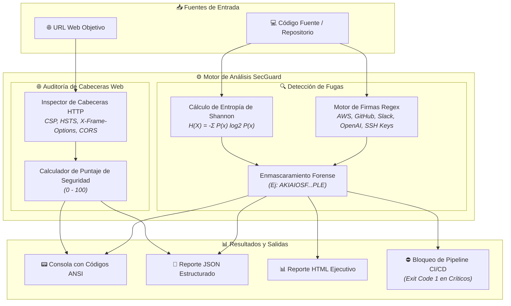

# 🛡️ SecGuard CLI: DevSecOps SAST & Secret Scanner

[](#)
[](#)
[](#)
[](#)

**SecGuard** es una herramienta de línea de comandos (CLI) de seguridad de aplicaciones (**AppSec / DevSecOps**) diseñada para prevenir fugas de credenciales en repositorios de código y auditar la postura de seguridad de servidores web.

Combina **detección basada en firmas regex** para los principales proveedores de nube con **análisis matemático de entropía de Shannon** para identificar tokens y secretos desconocidos.

---

## 🏗️ Arquitectura de Detección



---

## ✨ Características Principales

* 🔑 **Detección Determinista de Secretos:** Reglas integradas para AWS Access Keys, GitHub PATs, Slack Tokens, OpenAI Keys, Google Cloud API Keys, llaves privadas RSA/SSH y URLs de base de datos con contraseñas.
* 🧮 **Algoritmo de Entropía de Shannon:** Detecta contraseñas aleatorias complejas y hashes criptográficos sin importar el lenguaje de programación o formato.
* 🌐 **Auditoría de Cabeceras Web (OWASP):** Verifica `Content-Security-Policy`, `Strict-Transport-Security`, `X-Frame-Options`, `X-Content-Type-Options` y asigna un puntaje del 0 al 100.
* 📦 **Cero Dependencias de Terceros:** Desarrollado 100% sobre la biblioteca estándar de Python para máxima portabilidad, ligereza y cero riesgos de ataques de cadena de suministro.
* 🚀 **Listo para CI/CD:** Opción `--fail-on-critical` para bloquear despliegues en GitHub Actions si se detecta una fuga grave.

---

## 🚀 Instalación y Uso Rápido

### Opción 1: Ejecución directa con Python
```bash
# Entrar a la carpeta
cd secguard-cli

# 1. Escanear un directorio o carpeta en busca de secretos:
python3 -m secguard.cli scan ./test_samples

# 2. Auditar las cabeceras de seguridad de una página web:
python3 -m secguard.cli audit-url https://google.com

# 3. Exportar reporte a JSON y HTML:
python3 -m secguard.cli scan ./test_samples --json reporte.json --html reporte.html
```

### Opción 2: Instalar como comando global en tu sistema
```bash
pip install -e .
secguard scan .
```

### Opción 3: Ejecutar con Docker
```bash
docker build -t secguard .
docker run --rm -v $(pwd):/scan secguard scan /scan
```

---

## 🧪 Pruebas con Muestras Vulnerables

El proyecto incluye la carpeta `test_samples/` con vulnerabilidades simuladas (claves de prueba no reales de AWS, tokens de GitHub, Slack y secretos de alta entropía).

Para comprobar el escáner:
```bash
python3 -m secguard.cli scan ./test_samples
```

Verás cómo detecta de forma instantánea cada una de las claves y tokens con su nivel de severidad y línea exacta de código.
